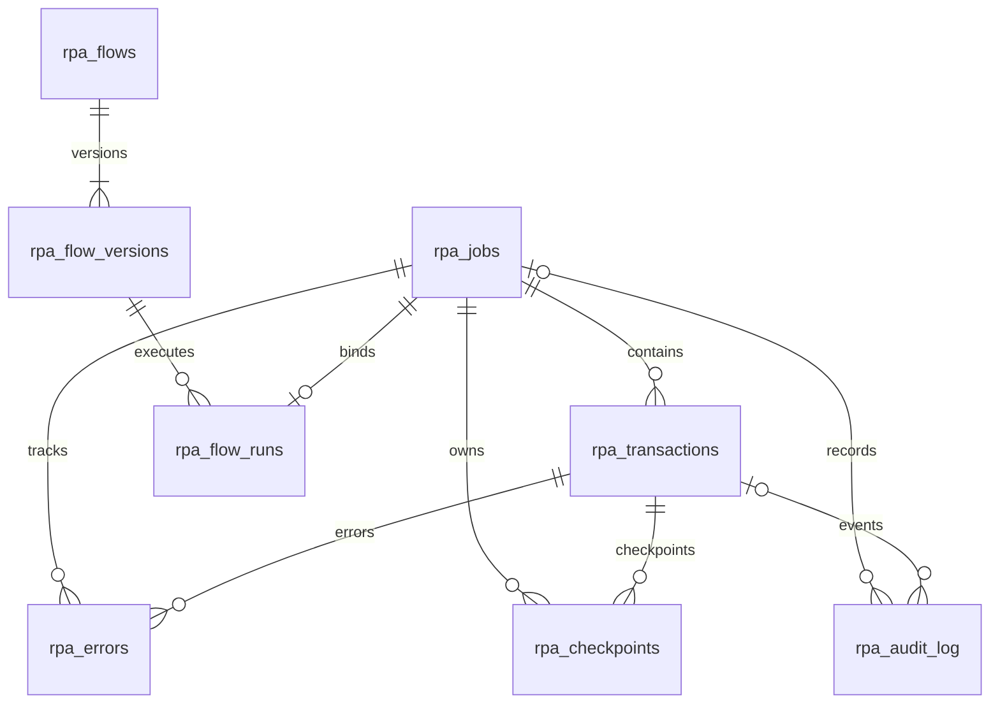

# MultiRPA

13 Ekim 2026: Ürünün adı **MultiRPA**. Mevcut durum, eksikler,
web/masaüstü ürünleşme sırası ve kabul ölçütleri
[MultiRPA uygulama planında](docs/MULTIRPA_PLAN.md) yer alır. Planın uygulaması başladı; tamamlananlar ve kalan işler planda ayrıdır. Güncel test sonucu [doğrulama kaydının](VALIDATION.md) başındadır.

Bu proje, kullanıcı tarafından ayarlanabilen **MultiRPA Akış Tasarımcısı** görsel akış editörü
ve PostgreSQL tabanlı RPA çalıştırma altyapısıdır. Adımları bağlayıp değişkenler,
koşullar, bekleme, tarayıcı, dosya, CSV/Excel, HTTP ve e-posta işlemleri oluşturabilir; akışı kaydedip gerçek
worker üzerinden çalıştırabilirsiniz. SQLAlchemy ve Alembic üzerinde sürümler,
job/transaction durumları, idempotency, retry, lease, checkpoint ve recovery yönetilir.

[MultiRPA Akış Tasarımcısı kullanım ve işletim rehberi](docs/FLOW_STUDIO.md), adımları, giriş
verilerini, hedef site yapılandırmasını ve API'yi açıklar. Belirli bir business
workflow tahmin edilmemiştir; kullanıcı kendi akışını oluşturur. Kimlik doğrulamalı
hedefler, zamanlama ve ek entegrasyonlar için gerekenler rehberde belirtilmiştir.

Geliştirme, bağımlılıklar ve testler **rpa-sunucu / srv1752189 / /opt/rpa** üzerinde
kalır. Başka sunucu projelerinin servislerine müdahale edilmez.

Ayrı müşteri portalında tanıtım sayfası, kayıt/giriş, e-posta doğrulama, parola
yenileme ve TOTP korumalı yönetici onayı eklendi. Yerel port **8770**; kurulum,
SMTP ve ilk yönetici komutları [kimlik ve onay rehberindedir](docs/IDENTITY_ONBOARDING.md).
Onaylı müşteri `/account` ekranında demoyu açıkça başlatıp `/workspace` üzerinden
kendi akışlarını oluşturabilir, çalıştırabilir ve zamanlayabilir. Bir takvim ayı
ve web/masaüstünde ortak üç kalıcı akış kimliği sınırı sunucuda uygulanır; silme
ve yeniden kurulum süreyi/kotayı yenilemez. Yürütme tabloları, repository'ler,
worker ve scheduler tenant sınırını ve güncel hesap/lisans haklarını uygular.

Electron Linux geliştirme paketi ortak editör ve bağımsız yerel Python runner
ile üretildi; paketli runner gerçek dosya/CSV/XLSX akışını tamamladı. Tek cihaz
Ed25519 ispatı ve en fazla 60 saniyelik imzalı izinlerle bağlanır. Yerel iş
verileri cihazda kalır. [Masaüstü rehberi](docs/DESKTOP.md), derleme ve kabul
sınırlarını açıklar. Windows UIA adımları kodlandı; gerçek Windows build,
imzalı yükleyici ve Windows kabul testi henüz yapılmadı.

Akış tanımları web ve masaüstü arasında sürümlü JSON dosyasıyla taşınabilir. **İçe aktar** dosyayı önizler; açık onayla yeni bir akış kimliği oluşturur ve kendiliğinden iş çalıştırmaz. **Dışa aktar** kaydedilmiş akışı alır; kasa parolaları, iş geçmişi ve lisans kayıtları dosyaya eklenmez. Akışa yazılmış sabit metinler dosyada kalır. [Aktarım kuralları](docs/FLOW_STUDIO.md#akışı-dosyayla-taşıma) kota ve yerel taslak davranışını açıklar.

12 Ekim aktarım tesliminin tam koşumu **854 passed, 2 warnings in 180.78s**;
skip/deselect veya hata yok. 0001–0008 migration döngüsü, Ruff ve
yapılandırılmış 45 kaynak dosyasında mypy geçti. Paketli Linux Electron'da
gerçek dosya içe/dışa aktarımı doğrulandı. 13 Ekim düğüm davranış sürümü ve
arşiv v1/v2 geçişi üzerinde çalışılıyor; önceki test/paket sonucu bu yeni
kodun kabulü sayılmaz. [Akış sözleşmesi](docs/FLOW_CONTRACT.md) uyumluluk
kurallarını ve sonraki döngü/alt akış tasarımını açıklar.
Gerçek alan adı, e-posta sağlayıcısı, ilk admin ve uzak production
PostgreSQL sağlanmadan müşteri yayını tamamlanmış sayılmaz. HTTPS proxy ve ayrı
API/execution/mail servisleri için [yayın profili](docs/DEPLOYMENT.md) hazırlanmıştır.

4 Ekim geliştirme kurulumu: veritabanı `0008_secret_vault` revision'ına yükseltildi;
8765 geliştirme paneli ve 8770 müşteri portalı açıldı. İzole backup restore ve
migration sırasında dokuz yürütme tablosunun kayıt kimliği/içeriği korundu.
Kanıt [doğrulama kaydındadır](VALIDATION.md). VS Code Ports bölümünden **8770**
portunu yönlendirin veya `ssh -N -L 8770:127.0.0.1:8770 rpa-sunucu` tünelini kullanın.
Ardından `http://127.0.0.1:8770/`, `/account`, `/admin` ve onaydan sonra `/workspace`
sayfalarını inceleyebilirsiniz.

```bash
.venv/bin/python scripts/portal_manage.py start
.venv/bin/python scripts/portal_manage.py status
# Yalnız bu projeye ait portalı durdurur; DB ve diğer servisler korunur:
.venv/bin/python scripts/portal_manage.py stop
```

Manager terminal kapandığında devam eden geliştirme process'ini PID, başlangıç
zamanı, cwd ve tam komutla doğrular; başka process'i durdurmaz. Sistem açılış
servisi değildir. `scripts/portal.py serve` ön planda çalıştırma seçeneğidir;
production ayrı systemd profilini kullanır. Gerçek admin ve SMTP rehberdeki
kurulum adımları tamamlanana kadar kayıt maili/ilk admin varmış gibi davranılmaz.

## Uygulamayı açma

Hazırlanmış sunucu kurulumunda:

```bash
cd /opt/rpa
.venv/bin/python scripts/manage.py start
.venv/bin/python scripts/manage.py status
```

Panel sunucuda **http://127.0.0.1:8765** adresindedir. Kendi bilgisayarınızdaki
tarayıcıya erişim sağlamak için yalnızca SSH port tüneli açın:

```bash
ssh -N -L 8765:127.0.0.1:8765 rpa-sunucu
```

Tünel açıkken tarayıcınızda **http://127.0.0.1:8765** adresini açın. VS Code Remote
SSH kullanıyorsanız Ports bölümünden sunucunun **8765** portunu forward edip
tarayıcıda açabilirsiniz. Kod, bağımlılıklar, veritabanı ve worker'lar sunucuda
çalışır; bilgisayarınız yalnızca bağlantıyı taşır. Panel public internete açılmaz.
Projedeki `.vscode/settings.json`, 8765 portunu MultiRPA etiketiyle otomatik
yönlendirme için tanımlar.

**İş akışları → Akış oluştur** yolundan görsel tasarımcıyı açın. Koşullu akış
şablonunda `girdi=evet` olumlu yolu, diğer değerler ikinci yolu izler.

Panelde ayrıca genel bakış, iş oluşturma ve arama, kayıt ekleme, işlem kuyruğu,
worker durumu, checkpoint/hata geçmişi, iptal ve sonuç doğrulama ekranları vardır.
Başarı, kontrollü tekrar ve kesinti/kurtarma demoları **Demo başlat** düğmesinden
çalıştırılır. Sunucu kurulumuna `demo-basarili-ornek`, `demo-kontrollu-tekrar` ve
`demo-kurtarma-ornek` adlarıyla üç etiketlenmiş örnek yüklenmiştir. Kurtarma
örneğindeki kayıtlar sonuç doğrulaması yapılana kadar incelemede kalır.

Erişim yetkisi SSH bağlantısıyla sağlanır; bu geliştirme panelinde internetten
giriş için ayrı kullanıcı/parola sistemi yoktur. Uygulama loopback adresine
bağlanır, Host/Origin ve istek başlıklarını denetler, production başlangıcını
reddeder. Public alan adıyla yayın için ayrıca kimlik doğrulama ve HTTPS gerekir.

`start` yalnızca proje için `rpa-dev` PostgreSQL container'ını hazırlar, development
migration'larını uygular ve ayrı oturumda Uvicorn başlatır. İlk kullanımda `.env`
yoksa rastgele kimlik bilgileriyle, yalnızca sahibine açık (`0600`) olarak oluşturur;
var olan `.env` dosyasını değiştirmez. Yalnızca `APP_ENV=development`, loopback DB
host'u ve `DB_NAME=rpa_development` kabul edilir. Başka bir uygulama web portunu
kullanıyorsa durdurulmaz; gerekirse `start --port 8766` kullanıp tünelde aynı portu
seçin.

```bash
# Yalnızca bu projenin web uygulamasını durdurur; PostgreSQL ve veriler korunur:
.venv/bin/python scripts/manage.py stop
```

Web process'i terminal kapansa da çalışmaya devam eder. Sunucu yeniden başlatılırsa
`start` komutunu tekrar çalıştırın; sistem servisi kurulmaz. Process kimliği
`.runtime/web.json` içinde PID ve başlangıç zamanı ile tutulur. Stop işlemi PID,
başlangıç zamanı, çalışma dizini ve tam Uvicorn komutunu doğrular; Linux pidfd ile
başka process'e yanlışlıkla sinyal gönderilmesini önler. Projeye ait log
`logs/rpa-web.log` dosyasındadır; HTTP access log'u kapalıdır. Kimlik bilgilerini,
environment dökümlerini veya ham driver hatalarını paylaşmayın.

İlk kurulumda `.venv` veya paketler yoksa aşağıdaki kurulum adımlarını tamamlayın.
Testler canlı development DB'si üzerinde çalıştırılmaz; ayrı test harness'ini
kullanın.

## Kurulum

Python 3.11 veya üzeri gerekir. Her komutu sunucuda proje dizininden çalıştırın:

```bash
hostname
pwd
cd /opt/rpa
python3 -m venv .venv
.venv/bin/python -m pip install -c requirements.lock -e '.[dev,browser,automation]'
```

`hostname` sonucu `srv1752189` değilse devam etmeyin. Sistem Python paketleri
değiştirilmez; `.venv` Git'e alınmaz. Bağımlılık aralıkları `pyproject.toml`, bu
sunucuda doğrulanan kesin runtime/test sürümleri `requirements.lock` içindedir.

Bu sunucuda Python `ensurepip` bileşeni bulunmadığından ilk `.venv` kurulumu için
resmi PyPA bootstrap yöntemi kullanılmıştır. `venv` komutu aynı nedenle hata
verirse sistem paketi kurmadan yalnızca proje environment'ına pip hazırlayın:

```bash
python3 -m venv --without-pip .venv
curl --fail --silent --show-error --location \
  --output /tmp/rpa-get-pip.py https://bootstrap.pypa.io/get-pip.py
.venv/bin/python /tmp/rpa-get-pip.py
.venv/bin/python -m pip install -c requirements.lock -e '.[dev,browser,automation]'
```

Bootstrap yöntemi [pip resmi kurulum dokümantasyonunda](https://pip.pypa.io/en/stable/installation/)
tanımlıdır. Bootstrap'ı sistem Python'u ile çalıştırmayın; yukarıdaki `.venv/bin/python`
kurulumu projede tutar. Mevcut `.venv` çalışıyorsa yeniden bootstrap gerekmez.

Environment değişkenlerini secret yönetiminden veya yalnızca bu projeye ait,
Git tarafından yok sayılan `.env` dosyasından sağlayın. `manage.py` bu dosyayı shell
eval veya değişken genişletmesi kullanmadan ayrıştırıp yalnızca kendi alt
process'lerine aktarır. Database katmanı `.env` dosyasını otomatik yüklemez.
Örnek dosyadaki değerler sahtedir; manager'ın otomatik oluşturduğu `.env` zaten
varsa aşağıdaki kopyalama adımı gerekmez:

```bash
cp -n .env.example .env
chmod 600 .env
```

`.env` içindeki sahte parolayı güvenli biçimde değiştirin. Geliştirme için
`APP_ENV=development`, `DB_HOST=127.0.0.1`, `DB_PORT=55432` ve
`DB_SSLMODE=disable` kullanabilirsiniz. Mevcut PostgreSQL servislerine ait portları
kullanmayın. `scripts/manage.py` ve yerel `scripts/portal.py` bu dosyayı
genişletme/eval yapmadan okur. Bağımsız komutlar için environment değerlerini
secret yöneticisinden sağlayın; dosyayı shell ile `source` etmeyin. Güvenilir
yerel dosyayla migration örneği [kimlik rehberindedir](docs/IDENTITY_ONBOARDING.md).

Shell debug/trace (`set -x`), `env`, `docker inspect` çıktısının tamamı ve
`docker compose config` sırları açığa çıkarabileceği için teşhis çıktısına eklenmemelidir.

## Sunucuda izole geliştirme PostgreSQL'i

Docker ve Compose mevcutsa aşağıdaki dosya yalnızca projeye ait development
instance'ını başlatır. Port sadece loopback üzerinden erişilir; veriler Compose
projesine ait kalıcı volume'da tutulur. Bu servis production deployment değildir.

```bash
docker compose -f compose.dev.yaml --project-name rpa-dev up -d --wait
.venv/bin/alembic upgrade head
.venv/bin/alembic current
```

`compose.dev.yaml` ve test harness, sunucuda çekilen resmi PostgreSQL 17 image'inin
`sha256:67f41722b7a8cbdb868a44a4995c846eddfdc2973bccb291ce937dce88ad5675`
digest'ine sabitlenmiştir. Image güncellemesini test ederek iki dosyada birlikte
uygulayın. Mevcut PostgreSQL'i
duraklatmak veya başka projelerin container/volume'larını temizlemek gerekmez.
Geliştirme container'ını işiniz bittiğinde yalnızca kendi proje adıyla kaldırın;
aşağıdaki komut volume'u korur:

```bash
docker compose -f compose.dev.yaml --project-name rpa-dev down
```

## Environment yapılandırması

| Değişken | Anlam / varsayılan |
| --- | --- |
| `APP_ENV` | `development`, `test`, `production`; varsayılan `development` |
| `DB_HOST`, `DB_NAME`, `DB_USER`, `DB_PASSWORD` | Zorunlu; kaynak kodda varsayılan sır yok |
| `DB_PORT` | PostgreSQL portu; varsayılan `5432` |
| `DB_SSLMODE` | Development/test varsayılanı `prefer`; production `verify-full` zorunlu |
| `DB_SSLROOTCERT` | İsteğe bağlı CA dosyası; belirtilmezse libpq güvenilir CA yapılandırması |
| `DB_POOL_SIZE`, `DB_MAX_OVERFLOW` | Worker process başına havuz boyutu ve ek bağlantı; `5`, `5` |
| `DB_POOL_TIMEOUT` | Havuzdan bağlantı bekleme sınırı; `30` saniye |
| `DB_CONNECT_TIMEOUT` | Tek bağlantı girişiminin sınırı; `5` saniye |
| `DB_CONNECT_ATTEMPTS` | Bağlantı edinme girişimi sınırı; `3`, izin verilen aralık `1..5` |
| `DB_STATEMENT_TIMEOUT_MS`, `DB_LOCK_TIMEOUT_MS` | Sorgu/kilit zaman aşımı; `30000`, `5000` ms |
| `RPA_TEST_DB_CONFIRM` | Testte `DB_NAME` ile tamamen aynı olmalı |
| `RPA_ALLOW_PRODUCTION_MIGRATIONS` | Production migration için komuta özel `yes` opt-in; normal çalışmada tanımlanmaz |

Connection string oluşturma SQLAlchemy `URL.create` ile yapılır. Pool,
`pool_pre_ping`, bağlantı zaman aşımı ve `hide_parameters=True` kullanılır; SQL echo
kapalıdır. Bağlantı edinme geçici hata nedeniyle sınırlı sayıda yeniden denenebilir.
Business işlem, transaction gövdesi ve sonucu belirsiz COMMIT otomatik tekrarlanmaz.
Ham driver exception'larını veya engine URL'sini kendi loglarınıza basmayın.
Pool ve kopan bağlantı davranışı için
[SQLAlchemy bağlantı havuzu dokümantasyonu](https://docs.sqlalchemy.org/en/20/core/pooling.html)
incelenebilir.

## Yapı ve şema

```text
app/
  core/                      # environment doğrulama, durumlar, domain hataları
  database/
    connection.py            # PostgreSQL engine, pool ve session yönetimi
    models.py                # SQLAlchemy şeması ve DB constraint'leri
    repositories/            # SQL, row lock, CRUD ve claim sorguları
    migrations/              # Alembic environment ve versiyonlu migration
  services/
    execution_service.py     # atomik durum geçişleri, idempotency, recovery
    flow_service.py          # sürümlü akışlar, atomik çalıştırma ve geçmiş
  identity/                 # kayıt, oturum, e-posta doğrulama, TOTP ve admin onayı
  entitlements/             # takvim aylık demo, ortak kota ve cihaz izinleri
  secrets/                  # tenant/alias/tür/sürüme bağlı AES-GCM bağlantı kasası
  desktop/                  # dar JSON-lines protokolü, SQLite ve yerel flow runner
  adapters/                 # dosya/CSV/Excel, HTTP, e-posta ve Windows UIA sınırları
  workflows/
    flow_engine.py           # graph doğrulama, değişkenler ve adım yürütme
    browser_actions.py       # izinli hedeflerde sunucu Chromium otomasyonu
    registered.py            # görsel motor ve incelenmiş kod otomasyonları
  workers/runtime.py         # registry, heartbeat ve fenced workflow yürütme
  web/                       # FastAPI kontrol API'si ve görsel akış editörü
scripts/manage.py            # development start/status/stop, process sahipliği
scripts/test_postgres.py     # tek kullanımlık gerçek PostgreSQL test ortamı
scripts/worker.py            # bağımsız worker process komutu
scripts/portal.py            # müşteri API, execution ve mail worker, ilk admin
scripts/portal_manage.py     # persistent loopback development portal start/status/stop
scripts/verify_backup.py     # yalnız yeni izole container'a gerçek backup restore/doğrulama
scripts/deployment.py        # sır okumadan yeni dizine yayın profili üretimi
desktop/                    # Electron kabuğu, ortak renderer ve platform build komutları
tests/                      # unit ve PostgreSQL entegrasyon testleri
```

| Tablo | Temel içerik / ilişki |
| --- | --- |
| `rpa_jobs` | UUID PK, tenant içinde unique `job_id`, workflow, status, başlangıç/bitiş, toplam ve terminal durum sayaçları |
| `rpa_transactions` | Tenant/job bileşik FK, tenant içinde unique idempotency key, record, external reference, status, attempt/budget, retry zamanı, worker owner, lease, fencing token, reconciliation işareti ve sonuç |
| `rpa_errors` | Job ve transaction FK; hassas payload yerine sınırlı, kontrollü hata kodu |
| `rpa_checkpoints` | Job ve transaction FK; transaction içindeki checkpoint key'e göre tek kayıt, küçük JSON state |
| `rpa_audit_log` | Job ve ilgili transaction'a bağlı geçiş/claim/recovery audit kayıtları |
| `rpa_flows` | Kullanıcı akışının güncel adı, açıklaması ve sürümü |
| `rpa_flow_versions` | Akış/sürüm bileşik PK; değiştirilemeyen graph ve metadata snapshot'ı |
| `rpa_flow_runs` | Tenant/job'a bağlı tek çalıştırma; tenant içinde unique request UUID, tenant/sürüm FK, girdi snapshot'ı ve idempotency özeti |
| `rpa_flow_schedules` | Tenant içindeki sabit sürüm, tek sefer/sabit aralık, revision, sonraki vade ve son iş |
| `rpa_identity_*` | Tenant, hesap, ayrı oturumlar, tek kullanımlık token, şifreli outbox ve yönetim audit'i |
| `rpa_entitlements` / `rpa_flow_reservations` | Tek demo başlangıcı/bitişi, ücretli hak ve silinmeyen ortak flow kota izi |
| `rpa_license_devices` / `rpa_device_challenges` | Tek aktif cihaz, challenge sahiplik ispatı ve son imzalı izin bitişi |
| `rpa_credentials` | Tenant/alias/tür/sürüm bağlamında şifrelenmiş bağlantı bilgisi ve silme tombstone'u |
| `alembic_version` | Uygulanmış migration revision'ı |



Initial migration: `app/database/migrations/versions/0001_execution_state.py`.
Görsel akış migration'ı: `app/database/migrations/versions/0002_visual_flows.py`.
Güncel head `0008_secret_vault`; `0006_execution_tenants` yürütme kayıtlarını
tenant kapsamına, `0007_entitlements` demo/kota/cihaz kayıtlarını kalıcı şemaya taşır.
Akış editörü, sürümleme, tarayıcı izinleri ve flow API işletimi
[MultiRPA Akış Tasarımcısı kılavuzunda](docs/FLOW_STUDIO.md) açıklanır.
UUID, timezone-aware timestamp, PostgreSQL JSONB, foreign key, unique/check
constraint'leri ve claim/recovery indeksleri bu migration ile oluşturulur.
Uygulama başlangıcında `create_all()` çalıştırılmaz. Şema değişikliklerini Alembic
revision olarak inceleyip uygulayın; ORM modeli tek başına veritabanını değiştirmez.
Revision/upgrade işletimi
[Alembic resmi kullanım kılavuzunda](https://alembic.sqlalchemy.org/en/latest/tutorial.html)
açıklanır.

## Durumlar ve execution API

Job `PENDING → RUNNING` ile başlar. Bütün transaction'lar terminal olduğunda
`finalize_job()` sonucu hesaplar: hata yoksa `COMPLETED`, yalnızca hatalar varsa
`FAILED`, hata ile başarı/skip birlikte varsa `PARTIALLY_COMPLETED`.
Boş job tamamlanabilir. Pending/running job iptal edilebilir; terminal job yeniden
açılamaz. Finalization devam eden veya reconciliation bekleyen iş varken reddedilir.

Transaction'ın normal yolu `PENDING → PROCESSING → SUCCESS / FAILED / SKIPPED`.
Kontrollü retry yolu `PROCESSING → RETRY → PROCESSING` olur. Terminal transaction
tekrar sahiplenilemez. Geçerli geçişler `app/core/states.py` ve service katmanında
tanımlıdır; business kodu doğrudan ORM state alanlarını değiştirmemelidir.

Workflow'dan bağımsız kullanım örneği:

```python
from app.core.config import DatabaseSettings
from app.database.connection import create_db_engine, create_session_factory
from app.services.execution_service import ExecutionService

settings = DatabaseSettings.from_env()
engine = create_db_engine(settings)
service = ExecutionService(create_session_factory(engine))

job = service.create_job("demo-run-001", "infrastructure_demo")
service.add_transaction(
    job.id,
    record_id="demo-record-001",
    idempotency_key="demo-source:demo-record-001:demo-operation",
    max_attempts=3,
)
service.start_job(job.id)
claim = service.claim(job.id, worker_id="demo-worker-1", lease_seconds=60)
if claim is not None:
    service.checkpoint(claim, "cursor", {"offset": 1})
    service.succeed(claim, result_data={"demo_complete": True})
service.finalize_job(job.id)
engine.dispose()
```

Bu örnek yalnızca altyapı davranışını gösterir. Gerçek business eylem eklenmeden önce
hedef sistemin idempotency ve reconciliation sözleşmesi tanımlanmalıdır.

Her service çağrısı kendi kısa DB transaction'ında tamamlanır. Worker bir kaydı
claim ettikten sonra DB kilidini açık tutarak dış sistemde işlem yapmaz. İşlem
sürerken `heartbeat(claim, lease_seconds=...)` ile lease'i yeniler; dönen `Claim`
nesnesini kullanmaya devam eder. Process/fork başına ayrı engine/session factory
oluşturun, aynı Session nesnesini thread'ler arasında paylaşmayın. Toplam bağlantı
bütçesini worker sayısı × (`DB_POOL_SIZE` + `DB_MAX_OVERFLOW`) olarak planlayın.

## Concurrency, idempotency ve retry

Claim, SQL transaction içinde `FOR UPDATE SKIP LOCKED` ve atomik state/owner
güncellemesi kullanır. Aynı transaction birden fazla worker'a aynı anda verilmez.
Job sayaçları ve job cancellation/finalization tutarlılığı için parent job satırı
da kilitlenir; aynı job'ın kısa claim/state yazmaları sıraya girebilir. Worker'ların
asıl business işlemleri claim transaction'ından sonra eşzamanlı yürür.
Kilitli kayıtları atlamanın kuyruk tüketicilerine uygunluğu ve tutarlı raporlama
sorgularındaki sınırları
[PostgreSQL SELECT locking clause dokümantasyonunda](https://www.postgresql.org/docs/17/sql-select.html#SQL-FOR-UPDATE-SHARE)
belirtilir.

Her claim bir owner ve artan fencing token taşır. Heartbeat, checkpoint,
success/fail/skip çağrılarında owner, token, aktif state ve henüz dolmamış lease
yeniden kontrol edilir. Lease zamanları PostgreSQL saatine göre değerlendirilir;
worker saat farkları hak sahipliğini belirlemez. Lease dolduğunda eski worker'ın
yazma yetkisi recovery henüz çalışmasa bile geçersizdir.

Idempotency key bir tenant'ın bütün job'ları arasında unique'tir. Başka tenant
aynı anahtarı bağımsız kullanabilir. Aynı key ve aynı business kimliği
(workflow, record, external reference) tekrar gönderilirse mevcut canonical
transaction döner; farklı parent job'a kopya eklenmez ve yeni job'ın sayacı artmaz.
Panelde bu durumda kaydın başka bir işte zaten bulunduğu açıklanır ve kayıtlı
olduğu iş açılır.
Aynı key'i farklı kimlikte kullanmak çakışma hatasıdır. `SUCCESS` kayıt tekrar
işlenmez. Key'i source + record + operation gibi kararlı bir kimlikten üretin;
attempt numarası veya rastgele job UUID eklemeyin. Aynı job içindeki record
benzersizliği için şemadaki constraint de korunur.

`max_attempts` ilk denemeyi içerir (`1..100`); sayaç yalnızca başarılı claim'de
artar. `fail(..., retryable=True)` sadece sonucu bilinen, tekrar edilmesi güvenli
hatalarda kullanılır. Backoff `min(base * 2**(attempt - 1), cap)` formülüdür;
service varsayılanları 1 saniye ve 300 saniyedir. Retry süresi gelmeden veya deneme
bütçesi bitince kayıt claim edilemez. Sınırsız retry ve transaction replay yoktur.

## Crash recovery ve reconciliation

Worker scheduler/operasyon katmanı belirli aralıklarla
`recover_stale(job.id, limit=100)` çağırır. Panelin demo worker'ları bu kontrolü
`infrastructure_demo` işleri için otomatik yapar; diğer akışlarda paneldeki
**Kurtarma kontrolü** düğmesi veya özel worker işletimi kullanılır.
Lease'i bitmiş `PROCESSING` kayıtlar, owner ve fencing token
geçersizleştirilerek `RETRY + reconciliation_required=True` durumuna alınır.
Deneme bütçesi bitmiş olsa bile belirsiz dış sistem sonucu atlanmaz. Bu kayıtlar
reconciliation tamamlanmadan claim edilemez.

1. Hedef sistemi idempotency key veya external reference ile sorgulayın.
2. İşlem gerçekleşmişse `reconcile(transaction_id, expected_fencing_token,
   outcome="succeeded", result_data=...)` çağırın; kayıt `SUCCESS` olur.
3. İşlemin gerçekleşmediği güvenilir biçimde doğrulandıysa `outcome="not_applied"`
   kullanın; kalan budget varsa retry açılır, yoksa `FAILED` olur.
4. Sonuç hâlâ bilinmiyorsa reconciliation işaretini koruyun; körlemesine tekrar
   etmeyin. `expected_fencing_token` recovery'nin döndürdüğü güncel kayıttan alınır.

`fail(..., outcome_uncertain=True)` de aynı reconciliation engelini kullanır.
`cancel_job()` güvenli bekleyen kayıtları `SKIPPED` yapar, aktif kayıtları
fencing ile geçersizleştirip reconciliation'a bırakır. İptal edilen job'ın belirsiz
işlemleri de hedef sistemde doğrulanmalıdır; `not_applied` sonucunda tekrar işlemek
yerine `SKIPPED` olur.

Database fencing eski worker'ın DB'ye yazmasını durdurur; dış sistemde devam eden
bir HTTP isteğini durduramaz. Exactly-once dış etki ancak hedef sistemin kalıcı
idempotency desteği veya güvenilir reconciliation protokolüyle sağlanabilir.
Checkpoint yalnızca aktif lease sahibi tarafından yazılır ve yeni owner tarafından
okunabilir; checkpoint'in varlığı dış business işlemin tamamlandığını kanıtlamaz.

JSON sonuç/checkpoint payload'ları 16 KiB ile sınırlıdır; belirgin secret alan
adları reddedilir. Bu filtre kişisel verileri tümüyle tespit etmez. Payload'ı çağıran
kodda en aza indirin ve hassas bilgileri kaldırın. Hatalarda UPPER_SNAKE_CASE,
en fazla 64 karakterlik kontrollü kod kullanın; exception metni, stack, screenshot,
erişim token'ı ve business belgesi kaydetmeyin.

## Gerçek PostgreSQL testleri

Güncel test sonuçları, komutlar ve doğrulama kapsamı
[VALIDATION.md](VALIDATION.md) içinde kayıtlıdır. Tarayıcı testleri ayrı komutla
çalıştırılır; bu seçim bir testin geçtiği anlamına gelmez.

Testler production veya development DB üzerinde çalıştırılmaz. En güvenli yol:

```bash
cd /opt/rpa
.venv/bin/python scripts/test_postgres.py
.venv/bin/ruff check .
```

Masaüstü ve mobil tarayıcı akışları da ayrı PostgreSQL üzerinde çalıştırılır:

```bash
.venv/bin/python -m pip install -c requirements.lock -e '.[dev,browser]'
# İlk kurulumda Chromium ve eksik Ubuntu 24.04 kütüphaneleri proje içine indirilir:
.venv/bin/python scripts/setup_browser.py
.venv/bin/python scripts/test_postgres.py -- -m browser tests/browser tests/test_flow_browser.py
```

Sistem paketleri kurulmaz; `.deb` içerikleri `.browser-cache/system` içine açılır.
Bu kütüphaneler yalnızca projenin tarayıcı process'lerinde kullanılır. Görsel kontroller
`artifacts/console-desktop.png` ve `artifacts/console-mobile.png` dosyalarını üretir.
Tarayıcı testleri iş/kayıt oluşturma, yinelenen işlem, iptal, başarı/retry,
kesinti sonrası sonuç doğrulama, mobil menü, taşma ve JavaScript/CSP hatalarını
denetler. Test tarayıcısında dış internet istekleri engellenir.

Harness Docker erişimi gerektirir; eksik erişim testin başarıyla geçtiği anlamına
gelmez. Kendi benzersiz `rpa-db-test-...` container'ını, rastgele parolayla, geçici
loopback portuyla, yalnızca bellekte data directory ile oluşturur. Container readiness
kontrolünden sonra aynı host portuna SQL bağlantısı kurup `current_database()` ile
beklenen hedefi doğrular. Önce Alembic
`upgrade head → downgrade base → upgrade head → check`, sonra pytest çalıştırır.
Başarı, hata ve Ctrl-C sonrasında yalnızca kendi invocation etiketiyle doğruladığı
container'ı kaldırır. `prune` ve mevcut servisleri durdurma işlemi yapmaz. SIGKILL
veya Docker daemon erişiminin kaybında otomatik temizlik garanti edilemez; script'in
yazdırdığı container adı ve sahiplik etiketini doğrulayarak yalnızca onu temizleyin.

Üst kabuk `APP_ENV=production` ise harness Docker'a erişmeden reddeder. Diğer
durumlarda inherited DB/PG/POSTGRES değişkenleri test alt process'lerine taşınmaz;
hedef her zaman harness'in yeni DB'sidir. Parola Docker argümanına yazılmaz,
environment ile aktarılır; test stdout'u ayrıca sır/URL sansüründen geçirilir.
Test DB'sindeki yüksek yetkili kullanıcı bu silinebilir instance ile sınırlıdır.

Unit testleri DB erişimi gerektirmeden çalıştırmak için:

```bash
.venv/bin/pytest -m 'not postgres' -q
```

Elle hazırlanmış **ayrı ve silinebilir** test PostgreSQL'i kullanılıyorsa
`APP_ENV=test`, loopback `DB_HOST`, `rpa_test_` ile başlayan `DB_NAME` ve aynı
`RPA_TEST_DB_CONFIRM` zorunludur. Testler bu koşulları connection öncesinde
doğrular; mevcut production environment ile test çalıştırmayın. Her test benzersiz
job/idempotency kimlikleri oluşturur; test sonunda satır satır temizlik yapılmaz.
Harness tamamlandığında bütün disposable instance kaldırılır. Elle hazırlanan test
DB'si test kayıtlarını tutar; production verisini bu hedefe koymayın.

```bash
# Yalnızca doğrulanmış ayrı test environment yüklendikten sonra:
.venv/bin/alembic upgrade head
.venv/bin/pytest -q
```

Entegrasyon testleri aynı anda çalışan worker'ların tekil claim'ini, global
idempotency'yi, retry budget/backoff'u, lease expiry/recovery sırasında eski
worker'ın heartbeat/checkpoint/finalization yetkisinin kaybını ve reconciliation
engellerini PostgreSQL üzerinde sınar. Test sayıları ve gerçek sonuçları değişiklik
teslimindeki test çıktısıyla değerlendirin; skip edilmiş test başarı kanıtı değildir.
`tests/test_process_workers.py` ayrıca dört ayrı `spawn` process'inin aynı anda
claim'ini ve commit edilmiş claim/checkpoint sonrasında gerçekten öldürülen worker'ın
yerine yeni process'in farklı fencing token ile güvenli devam etmesini doğrular.

## Production bağlantısı ve migration işletimi

Production PostgreSQL, bu uygulama sunucusundan ayrı yönetilen private network,
VPC/VPN/private subnet üzerindeki merkezi servistir. Public erişimi kapatın;
firewall erişimini yalnızca gerekli RPA sunucularına açın. `APP_ENV=production`,
uzak `DB_HOST`, secret yönetiminden alınan kimlik bilgileri, `DB_SSLMODE=verify-full`
ve güvenilir CA kullanın. Hostname sertifikayla uyuşmalıdır. Kod yerel production
DB'yi ve superuser/createdb/createrole yetkili bağlantıyı reddeder; ağ izinleri ve
tablo yetkileri ayrıca altyapı ekibi tarafından sınırlandırılır.

Runtime rolüne yalnızca gerekli şemada `USAGE` ve işlem ihtiyacına göre
`SELECT/INSERT/UPDATE/DELETE` haklarını verin; değişmez snapshot tablolarının
UPDATE/DELETE trigger koruması sürer. Migration sahibinden ayrı tutun. Runtime
rolüne DDL/schema ownership, superuser, rol/database oluşturma hakkı vermeyin.
Migration rolü gerekli schema DDL yetkisine sahip ayrı bir yönetilen rol olabilir;
onun da superuser/createdb/createrole olması gerekmez. Yeni tablolara runtime
grant'larını migration işletiminde sürdürün. Her iki rolün sırlarını ayrı yönetin.

Bu geliştirme kapsamında **production migration uygulanmaz**. Yetkili işletim
sürecinde önce staging/test migration, backup/restore doğrulaması ve kapasite
değerlendirmesi yapılmalıdır. Production environment yalnızca bu özel işletim
oturumunda sağlanır; migration guard normalde açık bırakılmaz:

```bash
# Yalnızca yetkili production işletim adımında, ayrı migration rolü ile:
RPA_ALLOW_PRODUCTION_MIGRATIONS=yes .venv/bin/alembic upgrade head
```

`downgrade base` tabloları kaldırır; sadece harness'in disposable test DB'sinde
kullanılır. Production geri dönüşü için önceden doğrulanmış, veri kaybını ve eski
worker'ların uyumluluğunu hesaba katan migration/restore planı gerekir.

## Backup, restore ve izleme

Production backup PostgreSQL altyapısının sorumluluğudur. Sağlayıcı tarafından
yönetilen günlük otomatik backup ve mümkünse WAL arşivleme/PITR kullanın; şifreli
yedeği ayrı erişim sınırları olan depoda tutun. Başlangıç saklama politikası ve
restore komutları [yayın rehberinde](docs/DEPLOYMENT.md) tutulur; gerçek süreleri
business RPO/RTO, veri saklama gereksinimleri ve bütçeyle belirleyin.
Backup başarısı/yaşı alarm üretmelidir.

Restore tatbikatı düzenli olarak ayrı bir PostgreSQL instance'ında yapılır:
yedeği geri yükleyin, schema revision'ını doğrulayın, FK/counter tutarlılığını
kontrol edin ve uygulama smoke testlerini bu kopyada çalıştırın. Hassas production
yedeklerini normal integration test DB'si olarak kullanmayın. Tatbikatın süresini
ölçerek RTO'yu doğrulayın; yalnızca backup dosyasının varlığı yeterli değildir.

Gerçek restore/cutover sırasında worker sahipliğinin eski snapshot'a geri dönebileceğini
hesaba katın. Yeni instance'a eski worker erişimini engelleyin, worker'ları koordine
edin ve belirsiz/dış etkili kayıtları hedef sistemde reconcile etmeden replay
yapmayın. Eski DB instance'ına ve yeni instance'a aynı anda aktif yazma açmayın.

Pending/retry yaşı, reconciliation bekleyen kayıt sayısı, expired lease sayısı,
attempt bütçesi tükenen kayıtlar, DB bağlantı/kilit zaman aşımı ve job terminal
sayaçları için metrics/alarm tanımlayın. Audit/error/checkpoint retention'ını
business ihtiyaçlarına göre belirleyin. Idempotency kayıtlarını silmek duplicate
önleme geçmişini kaldırır; hedef sistemin saklama süresi ve replay ufku bilinmeden
otomatik purge eklemeyin.

## Kalan entegrasyon kararları

Business workflow, kaynak/hedef sistem, idempotency key biçimi, reconciliation
kanıtı, worker orchestration ve kapasite/SLA değerleri henüz verilmemiştir.
Production PostgreSQL endpoint, ağ/TLS erişimi, least-privilege roller,
secret dağıtımı, backup ve izleme bu altyapı kullanılmadan önce sağlanmalıdır.
Demo worker'lar yalnızca altyapıyı ve paneli deneyebilmek içindir; bir gerçek
business workflow yerine geçmez. Görsel akışlar yalnızca kullanıcının tanımladığı adımları ve açıkça izin verilen
hedefleri kullanır. Geliştirme paneli SSH üzerinden kullanılabilir. Ayrı müşteri
portalında kullanıcı girişi/onay/demo ve tenant kapsamlı yürütme vardır.
Dosya/CSV/Excel/API/e-posta düğümleri ile HTTP, tarayıcı ve SMTP için yazma amaçlı
[bağlantı kasası](docs/SECRET_VAULT.md) eklendi; Windows UIA gerçek Windows kabulü
bekler. Linux masaüstü arşivi geliştirme sunucusuna bağlıdır. Gerçek alan adı,
SMTP, admin ve production PostgreSQL yapılandırması tamamlanana kadar dış yayın yoktur.

Tek seferlik ve sabit aralıklı zamanlama mevcuttur; kullanım ve sınırlar
[Zamanlama rehberindedir](docs/SCHEDULING.md). Kod dönüşüm kuralları
[MultiRPA mühendislik standardında](docs/ENGINEERING_STANDARDS.md) tanımlanmıştır.
