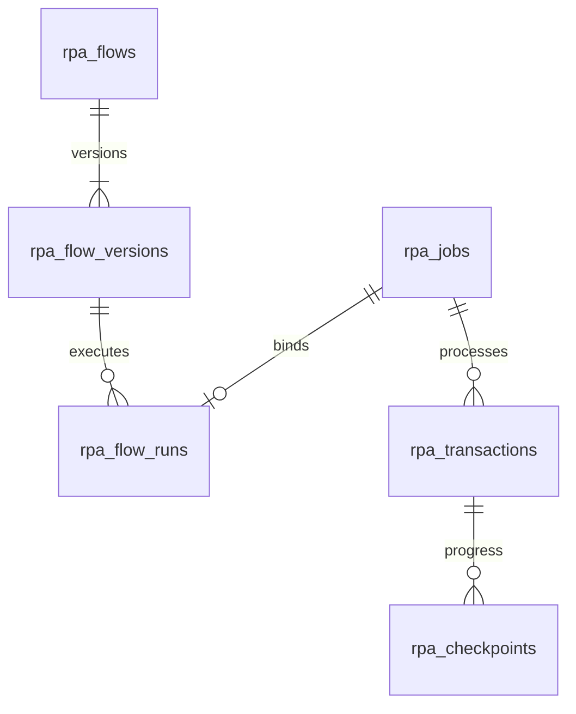

# MultiRPA Akış Tasarımcısı kullanımı ve işletimi

Güncelleme: 13 Ekim 2026. Ortak editör 20 düğüm türü sunar; Windows UIA gerçek
Windows kabulü bekler. Son tam test ve işletim kanıtı [VALIDATION.md](../VALIDATION.md) içinde.
12 Ekim aktarım teslimi doğrulandı; aşağıdaki düğüm sürümü ve arşiv v2
uyumluluğu 13 Ekim uygulama/doğrulama aşamasındadır.

MultiRPA Akış Tasarımcısı, kullanıcının adımları düzenleyip bağlayarak otomasyon oluşturduğu
görsel editördür. Kaydedilen akışlar PostgreSQL'de sürümlenir; **Çalıştır** işlemi
webde gerçek worker kuyruğuna, Electron'da aynı motoru kullanan yerel runner'a bir iş gönderir. Masaüstü çalışma deposu hesap başına SQLite'tır; otomatik web eşitlemesi yoktur. Ekrandaki ilerleme, sonuç ve hata bilgisi
bu işin transaction ve checkpoint kayıtlarından okunur.

## Açma ve ilk akış

Müşteri `8770/account` ekranında e-postasını doğrular ve admin onayından sonra
demoyu açıkça başlatır. **Çalışma alanına git** bağlantısı `/workspace#workflows`
üzerinden yalnız kendi akışlarını açar. Takvim aylık demo ve üç lifetime flow
kimliği web/masaüstünde ortaktır; silme/reinstall yeni hak vermez.
Electron kullanımı ve indirme/build sınırları [masaüstü rehberindedir](DESKTOP.md).

Aşağıdaki komutlar ayrı, SSH korumalı geliştirme paneli içindir. Sunucuda proje dizininde:

```bash
hostname
pwd
cd /opt/rpa
.venv/bin/python scripts/manage.py start
.venv/bin/python scripts/manage.py status
```

Beklenen hostname `srv1752189` olmalıdır. Bilgisayarınızdan sadece SSH tüneli açın:

```bash
ssh -N -L 8765:127.0.0.1:8765 rpa-sunucu
```

Tarayıcıda `http://127.0.0.1:8765/#workflows` adresini açın. Kod, veritabanı,
bağımlılıklar ve tarayıcı otomasyonu sunucuda çalışır.

1. **İş akışları → Akış oluştur** yolunu veya **Koşullu akışla başla** şablonunu açın.
2. Akışa bir ad verin. Sol kütüphaneden adım ekleyin; tuvalde sürükleyerek yerleştirin.
3. Bir adımın çıkışını, sonra hedef adımın girişini seçerek bağlantı kurun.
   Koşulun **Evet** ve **Hayır** çıkışlarının ikisini de bağlayın.
4. Adımı seçip sağdaki ayarlardan değişken, karşılaştırma, adres veya CSS seçicisini
   düzenleyin. **Düzenle** düğmesi adımları otomatik yerleştirir; **Sığdır** tüm akışı görünür yapar.
5. **Kaydet** ile kalıcı bir sürüm oluşturun. Eksik bağlantılar ve döngüler reddedilir.
6. **Çalıştır** penceresinde giriş değişkenlerini ve deneme sınırını belirleyin.
   **Çalıştırmayı başlat** sonrasında açılan iş ayrıntısından ilerlemeyi izleyin.
7. İşin kaydını açarak sonucu, checkpoint'i ve kontrollü hata kodlarını inceleyin.
   Editördeki çalıştırma geçmişi aynı akışın önceki işlerini gösterir.

Başka bir sekme aynı sürümü değiştirirse eski sekmenin kaydı `409` çakışmasıyla
reddedilir. Açık düzenlemenizi koruyup güncel akışı yeniden açın; eski içerik diğer
sekmenin kaydını sessizce ezmez. Kaydetme sırasında yeni sürüm oluşur; çalışmaya
başlamış iş kendi eski sürümünü kullanır.

## Akışı dosyayla taşıma

Web ve Electron aynı `.multirpa.json` tanımını kullanır. Otomatik eşitleme
olmadan akışı başka çalışma alanına taşımak veya ayrı bir tanım kopyası tutmak için:

1. Akışı **Kaydet** ile kaydedin. **Dışa aktar** yalnız kaydedilmiş ve değişiklik
   beklemeyen akışta açıktır; kaydetme sürerken kullanılamaz. Son kaydedilmiş
   sunucu/yerel sürüm dışa aktarılır. Web tarayıcısı dosyayı indirir;
   Electron işletim sisteminin kaydetme penceresini açar.
2. Hedefte **İş akışları → İçe aktar** yolundan dosyayı seçin. En fazla
   **128 KiB** UTF-8 JSON dosyası kabul edilir; önizleme akışın adını ve adım
   sayısını gösterir. Dosya seçmek tek başına kalıcı kayıt oluşturmaz.
3. **Akışı içe aktar** işlemiyle içe aktarmayı tamamlayın. Yeni UUID ve
   sürüm 1 oluşur; var olan akış veya sürümleri ezilmez. İçerik kendiliğinden
   çalıştırılmaz ve zamanlama oluşturulmaz.
4. Kasa referanslarını, hedef adresleri, dosya yollarını ve adımları inceleyin.
   Gerekli kasa bağlantılarını hedef çalışma alanında kurup **Çalıştır** yoluyla
   ayrı bir çalışma başlatın. Paket dosyası operatörün izinli hedeflerini değiştiremez.

Dosya seçimini oluşturma isteğini göndermeden kapatmak kayıt oluşturmaz.
**Akışı içe aktar** isteği gönderildikten sonra pencereyi kapatmak devam eden
oluşturmayı iptal etmez. Yanıt geç gelirse açık sayfanız ve yeni taslağınız korunur;
başarı bildirimi oluşturulan kopyanın akış listesine eklendiğini belirtir.

Webde içe aktarılan her kopya normal yeni akış gibi kota kullanır; dolu kota
veya bitmiş demo/lisans yeni kaydı engeller. Masaüstünde içe aktarma yerel taslak
oluşturur; çevrimdışı da düzenlenebilir. Merkezi kota ve geçerli cihaz izni ilk
çalıştırmadan önce alınır. İçe aktararak üç çalıştırılabilir akış sınırı aşılamaz.

Onaylı müşteri demo/lisansı bitse de kendi kaydedilmiş akışını dışa aktarabilir.
Webde süre dolunca yeni kayıt/içe aktarma ve yürütme kapalıdır. Mevcut taslağın
kaydedilmemiş değişiklikleri dışa aktarılan dosyaya eklenmez; önce kaydetmek gerekir.

**Dosyanın içeriği:** ad, açıklama, düğümler, bağlantılar ve kasa referans adları.
Akışa yazdığınız sabit metinler dosyada yer alır. Bağlantı kasasındaki parolalar
ve çalıştırma geçmişi aktarılmaz. Lisans/cihaz/oturum kayıtları, girdiler,
checkpoint'ler ve çalışma klasöründeki belgeler bu dosyaya eklenmez. Akışın
sabit metinlerinde müşteri verisi varsa dosyada da bulunur; otomatik anonimleştirme
veya genel sır bulma işlemi uygulanmış sayılmaz.

Taşıma zarfı yalnız şu alanları kabul eder:

```json
{
  "format": "multirpa-flow",
  "schema_version": 1,
  "flow": {
    "name": "Örnek akış",
    "description": "",
    "graph": {
      "nodes": [],
      "edges": []
    }
  }
}
```

Bu örnek yalnız zarfı gösterir; boş `nodes` çalışabilir akış değildir.
`schema_version`, dosya biçiminin sürümüdür; kaynak akışın kayıt sürümü veya
ayrı düğüm davranış sürümü değildir. Bu örnek, düğümlerinde `type_version`
alanı bulunmayan eski grafik için arşiv v1 zarfıdır. 13 Ekim sözleşmesinde
açık sürümlü veya karma grafik arşiv v2 ile taşınır; dışa aktarma grafiği
değiştirmeden uygun zarfı seçer. Bilinmeyen sürüm/alanlar, geçersiz grafik,
sonlu olmayan sayılar, uygunsuz Unicode, aşırı derinlik ve prototip anahtarları
reddedilir. İçerideki grafik mevcut **16 KiB / 2–40 düğüm / 78 bağlantı**
sınırlarını korur. Doğrulama sunucu ve masaüstü runner'da ortak sözleşmeyle yapılır.

## Düğüm davranış sürümü

13 Ekim uygulaması mevcut 20 türü v1 davranışına bağlar. Yeni eklenen düğümler
ve şablonlar `type_version: 1` yazar; eski akıştaki alanı bulunmayan düğümler
kalıcı olarak v1 anlamını korur. Eski akışı açmak veya dışa aktarmak bu alanı
eklemez. Eski akışa yeni düğüm eklendiğinde ikisi birlikte bulunabilir.

`type_version` tam sayı olmalıdır; `"1"`, `1.0`, `true` veya desteklenmeyen
bir sürüm kabul edilmez. Akışın kayıt sürümü, düğümün davranış sürümü ve
dosyanın arşiv sürümü birbirinden ayrıdır. İçe aktarılan kopyanın kayıt sürümü
1'den başlaması düğüm davranışlarını değiştirmez.

Şemada tanınan bir adım, her runner'da çalışabilir sayılmaz. Windows düğümü
Linux'ta düzenlenebilir; çalıştırma öncesinde runner yeteneği denetlenir.
Gerçek Windows kabulü ayrıca bekler. Uyumluluk ve ilerideki döngü/alt akış
tasarımı [akış sözleşmesinde](FLOW_CONTRACT.md) açıklanır. Bu değişiklik
döngü eklemez; **40 düğüm / 120 saniye** sınırı devam eder.

## Adımlar ve değişkenler

| Adım | Yapılandırma ve davranış |
| --- | --- |
| Başlangıç (`start`) | Bir akışta tek başlangıç; çalıştırma girdilerini alır |
| Değer ata (`set`) | Bir değişken adına sabit JSON değeri veya değişken başvurusu atar |
| Koşul (`condition`) | Eşittir, eşit değildir, içerir veya büyüktür karşılaştırması; `true` / `false` yolları |
| Bekle (`delay`) | Adım başına `0..10` saniye; beklerken sahiplik kontrolü sürer |
| Sayfa aç (`browser_open`) | İzin verilmiş HTTPS adresini sunucudaki Chromium ile açar |
| Alan doldur (`browser_fill`) | CSS seçicisinin bulduğu alana metin yazar |
| Tıkla (`browser_click`) | CSS seçicisinin bulduğu öğeye tıklar |
| Metin al (`browser_extract`) | Öğenin görünen metnini bir değişkene kaydeder |
| Bitiş (`end`) | Yapılandırılmış JSON sonuç alanlarını transaction sonucuna yazar |
| Dosya oku / yaz (`file_read`, `file_write`) | Hesabın çalışma kökünde UTF-8 metni okur veya atomik dosya değişimiyle yazar |
| CSV oku / yaz (`csv_read`, `csv_write`) | JSON satır dizisini UTF-8 CSV olarak okur/yazar |
| Excel oku / yaz (`excel_read`, `excel_write`) | XLSX dosyasında açık sayfa adıyla satır okur/yazar; formül çalıştırmaz |
| API isteği (`http_request`) | İzinli public HTTPS/443 hedefe GET/POST/PUT/PATCH/DELETE; status/body sonucunu değişkene alır |
| E-posta gönder (`email_send`) | SMTP kasa referansı, alıcı, konu ve metin ile izinli TLS hedefe gönderir |
| Windows tıkla / doldur / metin al (`windows_click`, `windows_fill`, `windows_extract`) | Tam pencere başlığı/auto_id/control_type ile UIA; yalnız yetenekli Windows runner, gerçek kabul bekliyor |

Girişte `{"musteri":{"ad":"Örnek"},"adet":3}` varsa `{{musteri.ad}}` ve `{{adet}}`
başvuruları kullanılabilir. Tamamı başvurudan oluşan değer JSON türünü korur;
`Merhaba {{musteri.ad}}` gibi metin içi başvurular metin üretir. Nesne/dizileri
metin içine gömmek yerine tam başvuru olarak kullanın. Eksik değişken kontrollü
`FLOW_VARIABLE_MISSING` hatasıdır. CSS/UIA seçicileri sabittir; görsel flow keyfi JavaScript/Python çalıştırmaz.
İncelenmiş Python workflow'ları registry üzerinden geliştirici tarafından eklenebilir;
bunlar kullanıcı JSON'undan eval/import edilebilir bir kod düğümü değildir.

Her akış `2..40` adım, en fazla 78 bağlantı ve 16 KiB tanım sınırındadır. Bütün
adımlar başlangıçtan erişilebilir olmalı ve yollar bir bitişe ulaşmalıdır.
Döngüler desteklenmez. Bir çalıştırma bir iş ve bir transaction üretir; giriş ve
çalışma değişkenleri 12 KiB, metin çıkarma sonucu 8 KiB ile sınırlıdır. Çalıştırma
süresi deneme başına en fazla 120 saniyedir. Sonuç/checkpoint toplam sınırı
16 KiB olduğundan sonuçlar da 12 KiB ile sınırlandırılır; adım geçmişi için alan
ayrılır. Deneme sınırı ilk denemeyi içerir ve `1..100` aralığındadır.

## Tarayıcı otomasyonu yapılandırması

Değer, koşul ve bekleme akışları ek hedef yapılandırması olmadan çalışır. Tarayıcı
adımları için proje ortamına Playwright/Chromium kurulmalı ve hedef alan adları
sunucuda açıkça izin listesine alınmalıdır:

```bash
cd /opt/rpa
.venv/bin/python -m pip install -c requirements.lock -e '.[dev,browser]'
.venv/bin/python scripts/setup_browser.py
```

Kurulum `.venv` ve `.browser-cache` içindedir; sistem paketleri kurulmaz. Gerekli
Ubuntu 24.04 kütüphaneleri de proje önbelleğine açılır. Projenin mevcut, `0600`
izinli `.env` dosyasına hedef listenizi ekleyin. Aşağıdakiler yalnızca sahte
değerlerdir; gerçek hedeflerinizin yerine geçmez:

```dotenv
RPA_BROWSER_ALLOWED_HOSTS=portal.example.com,static.example.com
```

Bir alan adı doğrudan kullanılmalı; protokol, yol, port veya `*` yazılmamalıdır.
En fazla 12 alan adı kabul edilir. Sayfanın ihtiyaç duyduğu API/asset alan adları
da listede bulunmalıdır. Listede olmayan istekler ve yönlendirmeler engellenir.
Bu ayar panelin erişim adresini belirleyen `RPA_ALLOWED_HOSTS` ayarından ayrıdır.

Mevcut tarayıcı politikası HTTPS/443 ve genel ağ adreslerine izin verir. Yerel,
private, link-local veya metadata adresleri reddedilir; DNS yanıtları doğrulanıp
çalıştırmaya ait yerel CONNECT proxy'sinde sabitlenir. Her TLS bağlantısı bu
sınırdan geçtiği için HTTP yönlendirmeleri de denetlenir. Böylece kullanıcı akışları sunucunun başka projelerine
istek gönderemez. Private ağdaki bir business hedefi için bu politikaya açık,
hedefe özel bir adaptör eklenmesi gerekir; genel private ağ istisnası bulunmaz.
İzole tarayıcı testlerindeki tek kullanımlık loopback istisnası Python test kodunda
sağlanır ve API/environment üzerinden açılamaz.

İzin listesini değiştirdikten sonra yalnızca RPA web/worker process'ini yenileyin:

```bash
.venv/bin/python scripts/manage.py stop
.venv/bin/python scripts/manage.py start
```

Bu işlem development PostgreSQL'i durdurmaz. Portal ortamını yenilerken
`scripts/portal_manage.py stop/start` kullanılır; production servisleri yayın
rehberindeki ayrı API/execution/mail süreçleriyle yenilenir.

Tarayıcı oturumu her çalıştırmada yenidir; cookie/profil indirme ve screenshot
saklanmaz. HTTP/browser/SMTP kimlik bilgilerini flow JSON'una veya girişlere
koymayın. Çalışma alanındaki **Bağlantı bilgileri** alanında yazma amaçlı kasa
kaydı oluşturup sabit `secret_ref` kullanın. Browser fill için boş `value` ve
`secret_field=username|password`, HTTP için isteğe bağlı kasa Authorization,
e-posta için zorunlu SMTP referansı uygulanır. API yalnız metadata döndürür;
[kasa rehberi](SECRET_VAULT.md) şifreleme ve sızıntı korumasını açıklar.

## Dosya, tablo, HTTP ve e-posta yapılandırması

Dosya yolu çalışma köküne göre `klasor/ornek.txt` gibi göreli olmalıdır. Mutlak
yol, `..`, backslash, symlink/junction ve özel dosyalar reddedilir. Web kökü
operatörün `MULTIRPA_WORKSPACE_ROOT/<tenant UUID>` dizinidir; varsayılan proje
`.runtime/workspaces` altıdır. Elektron'da hesap başına özel `files` klasörü
kullanılır; kullanıcı dosya seçicisiyle en fazla 1 MiB TXT/JSON/CSV/XLSX dosyası
alabilir. Bu dosya veya akış içeriği MultiRPA lisans sunucusuna gönderilmez.

Dosya boyutu en fazla 1 MiB; düğümden alınan veri en fazla 8 KiB; tablo en fazla
200 satır ve 32 sütundur. CSV/XLSX hücrelerinde formül/injection başlangıçları
reddedilir. XLSX dosyası açılırken XML/ZIP/kaynak sınırları uygulanır. Excel
adımları için `.[automation]` bağımlılıkları gerekir:

```bash
.venv/bin/python -m pip install -c requirements.lock -e '.[automation]'
```

HTTP/otomasyon mail hedefleri ayrıca `RPA_HTTP_ALLOWED_HOSTS` ve
`RPA_MAIL_ALLOWED_HOSTS` ile operatör tarafından izinli hale getirilir. Boş
liste adapter'ın dış ağ erişimini kapatır; flow belgesi listeyi değiştiremez.
HTTP yalnız public HTTPS/443 adresi kullanır; DNS sonucu doğrulanır ve bağlantı
adresine sabitlenir. Yönlendirme/özel ağ geçişi ve kimlik bilgisi taşıyan genel
header'lar kabul edilmez. Genel header'lar Accept, Content-Type ve Idempotency-Key
ile sınırlıdır; Authorization yalnız kasa referansından gelir.

E-posta düğümü platformun kayıt/doğrulama SMTP'sinden ayrı müşteri SMTP
credential referansı kullanır. SSL/465 veya STARTTLS/587, hostname/TLS doğrulama,
public IP ve izinli SMTP hostname zorunludur. SMTP DATA onayı kaybolursa gönderim
olmuş olabilir; flow otomatik tekrar göndermek yerine sonuç doğrulamaya alınır.
Yerel gerçek HTTPS/SMTP testleri geçmiş olsa da hedef müşteri sağlayıcısında
kabul ayrıca yapılır.

Windows üç UIA türü yalnız açık Windows kullanıcı oturumunda ve pywinauto ile
çalışabilir. Linux/web runner akışın bu yeteneğe ihtiyaç duyduğunu ilk etkiden
önce reddeder. Linux unit/build sonucu Windows'ta otomasyon kanıtı değildir.
Kilitli/gözetimsiz oturum ve uygulama açma/klavye ayrı gelecek kapsamdır.

Webde kaydedilmiş akışlar tek seferlik veya sabit aralıklı zamanlanabilir;
[Zamanlama rehberi](SCHEDULING.md) sunucu/hak sınırını açıklar. Electron'da yerel
scheduler yoktur; zamanlama menüsü gösterilmez.

## Sürüm, idempotency ve veritabanı şeması

`0002_visual_flows` üç tabloyu ekledi; `0006_execution_tenants` sahiplik ve
bileşik tenant FK/unique kapsamını uygular. Güncel head `0008_secret_vault`:

| Tablo | Kalıcı sorumluluk |
| --- | --- |
| `rpa_flows` | Akış UUID'si, güncel ad/açıklama, sürüm ve zamanlar |
| `rpa_flow_versions` | `(flow_id, version)` bileşik PK; sürümün ad/açıklama ve JSON graph snapshot'ı |
| `rpa_flow_runs` | Tenant/job FK/PK; tenant içinde unique request UUID, tenant/sürüm FK, girdi JSON'u, istek özeti ve deneme sınırı |



Sürüm ve çalıştırma snapshot'larının `UPDATE`/`DELETE` işlemleri PostgreSQL trigger'ı
tarafından reddedilir. Güncelleme yeni bir sürüm ekler. Runtime rolünün bu iki
tabloda `SELECT/INSERT`, akış metadata tablosunda `SELECT/INSERT/UPDATE` erişimi
yeterlidir; migration/DDL yetkisi ayrı yönetilir.

Yeni müşteri flow'u oluşturulurken ortak lifetime kota aynı transaction içinde
ayrılır. Yayın/worker/sonraki dış adımda güncel onay/askı/süre denetlenir.
Çalıştırma oluşturulurken job, transaction, sürüm bağlantısı ve audit kayıtları
tek DB transaction'ında yazılır. Job aynı transaction'da `RUNNING` olur; worker
yarım oluşturulmuş bir çalıştırmayı göremez. Tekrarlanan `request_id` aynı
flow/sürüm/girdiler/deneme sınırıyla mevcut işi döndürür. Farklı niyetle tekrar
kullanım `409` hatasıdır. Girdi özeti JSON türlerini ayırt eder; örneğin `true` ve
`1` aynı işlem sayılmaz. PostgreSQL sayısal biçimleri normalize etse de aynı
isteğin tekrarında yeni iş açılmaz. Tamamlanmış işlerde de aynı kural sürer.

## API

Aynı flow API geliştirme panelinde SSH/loopback sınırında, müşteri portalında
onaylı oturumun tenant kapsamında çalışır. Müşteri yazmaları ayrıca cookie/CSRF
ister. Yazma istekleri `Content-Type: application/json` ve `X-RPA-Request: 1` başlıklarını ister;
`Origin` gönderiliyorsa panelin protokol/host/port değerleriyle aynı olmalıdır.

| İstek | Sonuç |
| --- | --- |
| `GET /api/flows?limit=100&offset=0` | Graph içermeyen metadata listesi, toplam ve sayfalama |
| `POST /api/flows` | `{name, description, graph}` ile ilk sürüm; `201 {flow}` |
| `GET /api/flows/{id}` | Güncel graph dahil `{flow}` |
| `GET /api/flows/{id}/export` | `{document, filename}`; son kaydedilmiş tanım ve güvenli dosya adı |
| `POST /api/flows/import` | `{document}`; yeni kimlik/sürüm ve web kota kontrolüyle `201 {flow}` |
| `PUT /api/flows/{id}` | `{name, description, graph, expected_version}`; eski sürümde `409` |
| `POST /api/flows/{id}/runs` | `{request_id, version, inputs, max_attempts}`; `201 {job, flow_id, version}` |
| `GET /api/flows/{id}/runs?limit=50&offset=0` | Akışın işleri; snapshot adı/sürümü ve sayfalama |
| `GET /api/flows/runs/by-job/{job_id}` | Çalıştırmanın `{flow_id, version, name, graph, inputs}` snapshot'ı |

Dışa aktarma API'si JSON döndürür; web indirmesini ortak arayüz, masaüstü
kaydetmesini Electron main yapar. Dosya adı
`MultiRPA-flow-<uuid>-v<kaydedilmiş-sürüm>.multirpa.json` biçimindedir.
İçe aktarma istek gövdesi normal HTTP 128 KiB sınırını da karşılamalıdır.
Kaynak kimliği, tenant veya kayıt sürümü aktarım zarfında kabul edilmez.

Örnek çalıştırma gövdesi; UUID ve değerler yalnızca örnektir:

```json
{
  "request_id": "00000000-0000-4000-8000-000000000001",
  "version": 1,
  "inputs": {"mesaj": "Örnek", "adet": 3},
  "max_attempts": 3
}
```

Aynı HTTP isteğini bağlantı hatasından sonra tekrar denerken aynı request UUID'sini
koruyun. Yeni bağımsız çalıştırma için yeni UUID kullanın. `visual_flow` job'ları
genel job oluşturma endpoint'inden açılmaz ve bunlara sonradan kayıt eklenmez;
akış run endpoint'i kalıcı snapshot bağlantısını zorunlu kılar.

## Kesinti ve kurtarma

Görsel akışlar kayıtlı `visual_flow` worker'ları tarafından sahiplenilir. Engine,
her adım öncesinde sahipliği ve müşteri hesabının güncel hakkını kontrol eder ve `flow_state` checkpoint'ine adım
ilerlemesini yazar. Worker heartbeat'leri lease'i uzatır. Worker ölürse recovery
eski fencing token'ını geçersizleştirir; eski worker checkpoint/sonuç yazamaz.

Değer/koşul/bekleme akışları kalan adım ve değişkenlerden devam edebilir. Tarayıcı
oturumu çöken process ile kaybolur; dış dosya/HTTP/mail/UIA etkileri kalıcı effect
intent kaydıyla izlenir ve çözülmemiş etki sonraki denemede tekrar gönderilmez; işlem sonucu doğrulanıp tekrar açıldıktan sonra
yeni deneme baştan tarayıcı oturumu kurar. Bir dış eylem başladıktan sonraki hata,
körlemesine otomatik retry yerine sonuç doğrulama kuyruğuna alınır. Panelde
**Sonuç doğrulama** ile hedefte işlemin gerçekleştiğini veya gerçekleşmediğini
kanıtladıktan sonra karar verin. Hedefte yan etki yaratmış tıklamayı sadece DB
checkpoint'ine bakarak tekrar etmeyin.

DB fencing dış sisteme zaten gönderilmiş isteği geri alamaz. Kritik dış işlemlerde
hedef sistemin idempotency/reconciliation sözleşmesi ayrıca gereklidir. Yapılandırma
hataları kontrollü `FLOW_*` kodlarıyla gösterilir; hedef yanıtı veya ham exception
kimlik bilgileriyle birlikte loglanmaz.

## Bağımsız worker

Panelin kendi iki görsel akış worker'ına ek olarak ayrı process çalıştırılabilir.
Registry yalnızca incelenmiş Python tanımlarını kabul eder; akış girdileri keyfi
modül veya Python kodu seçemez. `app/workflows/registered.py` içindeki
`build_registry(session_factory)` görsel motorun kayıt noktasıdır.

```bash
# DB bağlantısı açmadan kayıtlı akış adlarını gösterir:
.venv/bin/python scripts/worker.py --list
# DB_* ve APP_ENV önceden ortam/secret yöneticisinden sağlanmış olmalı:
.venv/bin/python scripts/worker.py --workers 2 --lease-seconds 30
```

Worker komutu `.env` dosyasını kendiliğinden yüklemez. Birden fazla process
PostgreSQL üzerinden güvenle kayıt sahiplenebilir. Paneldeki worker listesi panel
process'inin worker'larını gösterir; bağımsız process'lerin sistem genelindeki
keşfi ve izlenmesi ayrıca işletim katmanında yapılmalıdır.

## Migration ve doğrulama komutları

`scripts/manage.py start` sadece doğruladığı proje development DB'sine migration
uygular. Mevcut çalışan sürümü yükseltmek için önce RPA process'ini durdurup
`start` çalıştırın. Production migration bu geliştirme işleminin kapsamında değildir.

Tüm test komutları sunucuda `/opt/rpa` dizininden çalışır; harness her seferinde
ayrı, silinebilir PostgreSQL container'ı oluşturur. Development/production verisi
test hedefi yapılmaz:

```bash
.venv/bin/python scripts/test_postgres.py
.venv/bin/python scripts/test_postgres.py -- tests/test_flow_persistence.py tests/test_flow_api.py
.venv/bin/python scripts/test_postgres.py -- tests/test_flow_engine.py
.venv/bin/python scripts/test_postgres.py -- -m browser tests/browser tests/test_flow_browser.py
.venv/bin/ruff check .
.venv/bin/ruff format --check .
.venv/bin/python -m pip check
```

Harness her çalıştırmada `upgrade head → downgrade base → upgrade head → alembic
check` kontrollerini yalnızca kendi test DB'sinde yapar. `downgrade base` veriyi
siler; çalışan development veya production DB'sine uygulanmaz. Son doğrulanmış
test sonuçları [VALIDATION.md](../VALIDATION.md) içinde tutulur.
